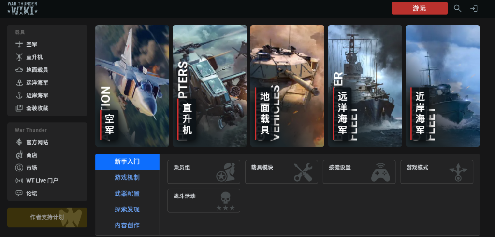

# 战争雷霆维基汉化 (War Thunder Wiki Zh)

[](https://github.com/tzdy1993/war-thunder-wiki-zh/releases)
[](https://warthunder.com/)
[](https://opensource.org/licenses/MIT)

《战争雷霆》(War Thunder) 官方 Wiki（[wiki.warthunder.com](https://wiki.warthunder.com/)）全量界面、科技树与载具武器参数简体中文汉化用户脚本。

---

## 📷 效果预览



---

## 🚀 一键安装 / 自动更新

| 安装渠道 | 适配网络环境 | 安装入口 |
| :--- | :--- | :--- |
| **GitHub Raw 直链** | 国际网络 / 开启代理 | [👉 点击一键安装 (GitHub)](https://raw.githubusercontent.com/tzdy1993/war-thunder-wiki-zh/main/wt-wiki-zh.user.js) |
| **国内高速加速镜像** | **国内直连（推荐国内玩家）** | [👉 点击一键安装 (国内加速)](https://ghproxy.net/https://raw.githubusercontent.com/tzdy1993/war-thunder-wiki-zh/main/wt-wiki-zh.user.js) |
| **脚本猫 (ScriptCat)** | 国内直连 | [👉 前往脚本猫安装页面](https://scriptcat.org) |

> 📌 **安装提示**：浏览器需预先安装 **篡改猴 (Tampermonkey)**、**暴力猴 (Violentmonkey)** 或 **脚本猫** 扩展，点击上方链接即可自动弹出安装确认窗口。后续脚本更新将在后台全自动同步！

---

## 手动安装方法

1. 安装浏览器扩展“篡改猴”或“暴力猴”。
2. 将 [wt-wiki-zh.user.js](https://raw.githubusercontent.com/tzdy1993/war-thunder-wiki-zh/main/wt-wiki-zh.user.js) 文件内容复制，进入扩展管理面板新建脚本覆盖保存。
3. 刷新进入 [War Thunder 官方 Wiki](https://wiki.warthunder.com/) 即可生效。

## 当前翻译范围

- Wiki 顶部导航、按钮、分类、标签和固定提示。
- 载具资料页的等级、战斗权重、国家、角色、规格、武器、经济、改装件和设置字段；其中固定词按客户端官方简中语言包校准。
- 本地官方简中术语表中的载具、武器和改装件名称。
- 动态加载的固定界面文本。
- 组合格式固定文本，例如 `Rank VIII`、`AB / RB / SB`、`Basic → Reference`、日期、评分统计、单位和数量前缀。
- 资料页的性能、襟翼、武器、经济、评分和标签字段；脚本会重新生成官方载具名称索引，补齐非链接的研发顺序和页面标题。
- 飞行控制两行标签（`<div>Air<br>brake</div>`）按整词翻译：着陆襟翼 / 起飞襟翼 / 战斗襟翼 / 减速板 / 起落架收放。
- 数值容器尾部单位翻译（`hp/t`→`马力/吨`、`km/h`→`公里/小时` 等，含模式切换拼接值如 `27.2…42.1 hp/t`）。
- 版本名（`Update 1.45 "Steel Generals"`→`更新 1.45「钢铁将军」`，UPDATE_NAMES 86 条）。
- **原文/翻译切换**：页面右下角悬浮按钮（「原文」↔「中文」），一键恢复所有翻译为英文原文或重新翻译，
  基于运行时记录（Map 记录每个被翻译节点的原文 + data-wt-zh-original-title 记录属性），
  切换后 MutationObserver 暂停/恢复，不影响页面模式切换控件。

## 明确不翻译（含涂装名）

- 文章正文、文章页标题（URL 数字/video/tips 开头的 h1）。
- 涂装名（载具页 `game-unit_camo` 的 title 属性）——UGC/市场涂装保留英文原文，与游戏内显示一致。
- 评论正文和用户自由内容。
- 用户名、搜索框输入值和代码/预格式文本。
- 外部页面内容。

## 明确不翻译

- 文章正文。
- 评论正文和用户自由内容。
- 用户名、搜索框输入值和代码/预格式文本。
- 外部页面内容。

脚本使用内嵌本地词典，不调用翻译 API，不上传页面内容。

## 文件说明

- `wt-wiki-zh.user.js`：直接导入暴力猴的成品脚本。
- `wt-wiki-zh.core.js`：核心逻辑源码（含人工词典 FIXED_TRANSLATIONS / CAMO_TRANSLATIONS）。
- `build_wiki_userscript.py`：从 `wt-zh-all.csv` 重新生成成品脚本（只重写生成区，不动人工词典）。
- `wt-wiki-zh.core.test.js`：核心替换规则测试。
- `check_conflicts.py` / `check_conflicts.js`：错翻检测（同键不同译 + 制造商标冲突），支持标记字符剥离与已确认分流清单。
- `overtranslation_scan.js`：过度翻译检测（保护区域命中扫描 + 运行时豁免回归守护）。

## 本地验证

```bash
node wt-wiki-zh.core.test.js
python build_wiki_userscript.py
node --check wt-wiki-zh.user.js
node audit_coverage.js   # 对照页面快照审计漏翻，FIX 应为 0
```

`test/snapshots.md` 是 8 类代表页面（首页、空军/陆战/海军资料页、直升机、飞机、收藏、文章）的文本快照；`audit_coverage.js` 会把快照中每个固定词与脚本词典比对并输出 `FIX`（应翻译未覆盖，目标为 0）和 `KEEP`（文章标题/作者/正文/图注/专名，按设计保留原文）两类。

## 全面审查方案（版本更新后如何更新脚本）

游戏更新 / Wiki 出新内容后，按以下顺序执行（全部已自动化）：

```bash
# 1. 官方数据源同步（游戏更新后：新载具、新武器、新文本）
python war-thunder-zh/updates_full.py      # 官方更新名 workshop 词条
python war-thunder-zh/unlocks_extract.py   # 官方涂装/贴花/勋章词条

# 2. 全站爬取（新页面、新内容）
python war-thunder-zh/crawler.py           # 爬取全部页面 HTML 到 test/site/

# 3. 一键管线（弹窗提取 → 全量审计 → 官方核对 → 测试 → 构建 → 语法检查）
python war-thunder-zh/run_pipeline.py
```

管线门禁：
- 全量审计（页面文本 + 弹窗 data 属性，共 58M 字符）必须 `unique FIX: 0`
- 官方译名核对（verify_official.py）：FIXED 中官方有词条的必须与官方一致
- 核心测试、语法检查必须通过
- FIX > 0 时：先查官方语言包有无词条（有 → 生成器自动并入），
  官方没有的 Wiki 硬编码文本 → 人工确认后加入 FIXED_TRANSLATIONS

人工补充入口：`war-thunder-zh/add_fixed.py`（词条表 + 插入）。

## 全面审查方案（漏翻 + 错翻 + 过度翻译，逐字审查）

审查分三个维度，覆盖"该翻没翻 / 翻了翻错 / 不该翻却翻了"三类问题，
数据源 = 本地全站快照（`test/site/` 5706 页 + `site-texts.md` + `popover-texts.md`）+ 线上 Wiki 实测。

### ① 漏翻（该翻没翻）
- `audit_coverage.js` 全量比对（页面文本 + 弹窗 data 属性，58M 字符），`unique FIX` 必须为 0。
- FIX > 0 时：先查官方语言包有无词条（有 → 生成器自动并入），
  官方没有的 Wiki 硬编码文本 → 人工确认后加入 FIXED_TRANSLATIONS（入口 `add_fixed.py`）。

### ② 错翻（翻了翻错）
- `verify_official.py`：FIXED 中官方有词条者必须与官方一致。
- `check_conflicts.py` / `check_conflicts.js`：同键不同译冲突报告（剥离显示标记字符，
  已确认的上下文分流在 `INTENTIONAL` 清单，新冲突标 `需定夺`）。
- 上下文规则回归：飞行控制整词（减速板等 5 项）、改装树「机动改装」vs 特性块「机动性」、
  BR 行模式标签（街机/历史/全真）、NVD 官方词条。

### ③ 过度翻译（不该翻却翻了）
- **保护清单**（保持原文）：涂装名（UGC/市场涂装 title，与游戏内显示一致）、
  文章页标题与正文（URL 数字/video/tips 开头时 h1 与正文均保护）、评论/用户内容、
  武器/雷达/弹药型号专名、日文转写、内部 ID。
- `overtranslation_scan.js` 全站扫描保护区域命中：
  `camo/article/comment` 三类修复后必须为 0（运行时豁免/保护已内置，扫描器带回归守护）；
  `h1` 类按页面类型甄别（载具/收藏页标题该翻，文章页已保护）；
  `collection` 类为收藏条目（该翻为主，仅报告）。
- 浏览器实测：文章页（h1 原文）、载具页（涂装 title 原文 + 飞行控制）、
  收藏页（条目翻译）、首页（导航）逐字核对。夹具：`test/runtime-test.html`（飞机页）、
  `test/runtime-test2.html`（坦克页）、`test/runtime-article.html` + `test/route_server.py`
  （文章页，模拟文章 URL 路径验证 h1 保护）。

### 已知上下文分流（有意为之，勿改回单译）
- `Air`：表头 Air/Ground/Naval 用「空中」；飞行控制 Air brake 由代码整词规则处理为「减速板」。
- `Mobility`：特性块标题「机动性」；改装树分区标题按 DOM 上下文输出「机动改装」。
- `NVD`：特性/裸文本「夜视仪」（官方）；官方 mod 词条「改进夜视设备」走 TERM，互不覆盖。
- `Spitfire Mk IXc`：官方语言包为「喷火 Mk IXC」（大写 C），FIXED 已对齐。
- 涂装名一律保留英文原文（含官方涂装词条），仅 UGC/市场涂装 title 豁免翻译。
- **模式切换控件（`show-char-*`）脚本不触碰**（页面 JS 管理显隐，脚本只做单位拆分翻译，
  不收集/不翻译/不合并其文本，避免破坏切换数据）。
- 数值容器 `game-unit_chars-value` 的拼接文本（页面 JS 增量更新）只做尾部单位翻译，不动数字部分。

每次版本更新跑 `python war-thunder-zh/run_pipeline.py`，然后按上述 ③ 的扫描器 + 浏览器实测收尾。
